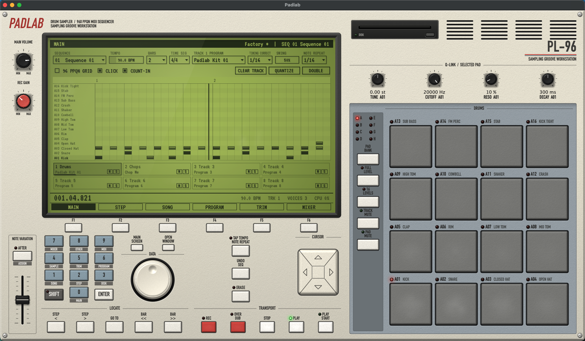
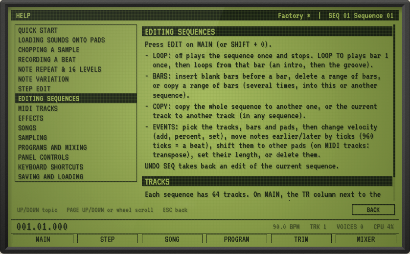

# Padlab

A desktop sampling groove workstation built for research. It reproduces the workflow and feel of classic pad-based samplers, using an original name, UI and synthesized factory sounds. It doesn't use or contain any third-party firmware, samples or artwork.

C++20 / JUCE 8, macOS (Apple Silicon tested). The core is platform-neutral.



## Look

The look is modelled on a classic 90s hardware sampler, with no third-party logos or panel artwork. The panel is laid out the way those machines are:
- **Top left:** the backlit LCD in a moulded bezel, with six soft keys (F1–F6) under it. MAIN VOLUME and REC GAIN knobs sit beside it.
- **Below the LCD:** a numeric keypad (each key's SHIFT mode is printed under it), MAIN SCREEN / OPEN WINDOW, the DATA wheel and the CURSOR keys. TAP TEMPO/NOTE REPEAT, UNDO SEQ and ERASE are next to them, with the LOCATE and TRANSPORT rows below.
- **Far left:** a NOTE VARIATION fader with its AFTER key.
- **Top right:** a 3.5" floppy drive bay (the DISK menu), vent slots and the model badge.
- **Right:** Q-Link knobs, then the pads in a blue-grey plate. A column beside the pads holds the A–H bank LEDs, PAD BANK, FULL LEVEL, 16 LEVELS, TRACK MUTE and PAD MUTE.

Materials:
- Light cream powder-coated chassis, screws and silkscreened section labels (DIN Condensed).
- Flat, matte grey rubber pads set into a blue-grey plate, with their labels and status LEDs printed above them. They give slightly when struck. The most-played pads (bottom row) and keys (PLAY, STOP, REC) are polished from wear.
- Low, flat moulded keys (red REC/OVERDUB, white transport, blue-grey keypad, dark SHIFT). Legends and LED dots are printed on the panel above each key.
- A cream **DATA wheel** with a finger dimple, in a black collar. A cream four-way CURSOR block. Knurled knobs (REC GAIN has a red cap) and a ribbed fader cap.
- A backlit green dot-matrix LCD with pixel grid, vignette, glass sheen and a few faint fingerprint smears. Everything on the screen is drawn in one ink colour using VT323 (SIL Open Font License, `assets/fonts/VT323-OFL.txt`).

Pads, key caps, knobs, LEDs, screws and paint grain are rendered by `src/ui/Materials.cpp`. It's a small per-pixel shader that describes each part as a height field and lights it with one top-left key light (Lambert diffuse plus Blinn-Phong specular, micro-bump grain). Results are cached at device-pixel resolution.

UI performance:
- The static chassis is rendered once per window size.
- The LCD content and its ink shadow are cached together, and rebuilt only when the screen's content changes.
- The playhead and meters live on a lightweight overlay.
- Pads repaint individually.
- On a smaller window, the screens are scaled as a whole (like a smaller display) instead of being squeezed. The minimum window size is 1280×800.

Release build: about 3% CPU idle and about 17% while playing (mostly the pad hit animation), about 140 MB of memory.

## Build & run

### Requirements (macOS)

- **Xcode Command Line Tools** (compiler and git): `xcode-select --install`
- **CMake 3.22+ and Ninja**, e.g. with [Homebrew](https://brew.sh): `brew install cmake ninja`

### Build

From the project folder, run these one at a time:

```sh
bash scripts/bootstrap.sh
cmake -S . -B build -G Ninja -DCMAKE_BUILD_TYPE=Release
cmake --build build
open build/Padlab_artefacts/Release/Padlab.app
```

- `bootstrap.sh` downloads JUCE 8.0.15 into `external/`. It isn't committed to git.
- The first build compiles JUCE too, so it takes a few minutes.
- To run the engine and import tests: `./build/PadlabTests_artefacts/Release/PadlabTests`

## How to

Press **HELP** on the panel (under the floppy drive) or `?` for the same guides inside the app. HELP opens on the topic for the screen you're on.



### Load sounds onto pads
1. Drag audio files from Finder onto a pad. Several files fill the following pads.
2. Or hit a pad to select it, open **PROGRAM** (F4) and press **LOAD** on layer 1. Layers 2–4 can hold more sounds for different velocities.
3. WAV, AIFF, FLAC and OGG load as they are. MP3, M4A and AAC are converted to WAV.
4. Loading onto a pad replaces its sound, so this is also how you swap a kit's kick or snare.
5. To record a new sound, use **SAMPLE** (SHIFT + 4): pick the input, set REC GAIN, press ARM, then KEEP.

### Chop a sample
1. Put the sample on a pad and hit the pad.
2. Open **TRIM** (F5).
3. Choose a chop mode:
   - **Threshold** finds the hits; raise SENSITIVITY for more slices.
   - **Regions** cuts equal slices.
   - **BPM** cuts on the beat.
   - **Manual** starts with no slices.
4. Press **CHOP** or `H`.
5. Fix the chops (the same in every mode):

   | Do this | To |
   |---|---|
   | Click a slice | Hear it |
   | Double-click / Shift-click | Add a chop |
   | Cmd-click / Alt-click | Delete the nearest chop |
   | Drag a chop line | Move it (or nudge it with SLICE START and the DATA wheel) |
   | `Delete` / `Cmd-Delete` | Delete the selected slice's chop / clear all chops |
   | `P` then `M` | Play the sample and tap chops in time |
   | `J` / `K` | Previous / next slice |
   | `T` | Trim the sample to the selected slice |
   | Scroll wheel / trackpad pinch | Zoom in around the pointer, down to single samples, for exact chop placement |
   | Shift + wheel / sideways swipe | Scroll along while zoomed (or drag the position strip along the bottom) |
   | `0` | Show the whole sample again |

6. Use the slices:
   - **CONVERT SLICES TO PADS** puts each slice on its own pad. It can also write a sequence that replays the loop and set the tempo from it.
   - **CHOPS PLAY** sets how the chop pads play when you hit several. **Poly** lets them ring over each other. **Mono** plays one at a time: each new chop cuts off the last, because they share a mute group (one no other pad uses). Changing it also updates chops already converted into that program.
   - **PAD PLAYS THIS SLICE** sets the current pad to play only the selected slice.

### Record a beat
1. On **MAIN**, set the sequence, bars and tempo. TAP TEMPO works too.
2. Set TIMING CORRECT (1/16 is a good start) and SWING (54–62% for a lazy feel).
3. Arm **REC** (`,`) to replace what's on the track, or **OVERDUB** (`.`) to add to it, then press **PLAY**.
4. Hold **TAP TEMPO/NOTE REPEAT** and a pad for repeats. Hold **ERASE** and a pad to delete that pad's notes.
5. **UNDO SEQ** (`Cmd-Z`) takes back the last pass.
6. Fine-tune individual notes in **STEP EDIT** (F2).

### Use a MIDI controller (e.g. MPK Mini)
Plug it in. It works whether you connect it before or after starting Padlab. The screen shows "MIDI IN: <device> connected", and the OTHER screen lists the controllers Padlab is listening to.

| Controller sends | Padlab does |
|---|---|
| Notes 36–51 (any channel) | Pads 1–16 of the current pad bank, velocity-sensitive (switch banks with PAD BANK or `[` `]`) |
| Aftertouch (poly or channel) | Pressure: note repeat gets louder as you press harder |
| CC 70–73 | The four Q-Link knobs: tune, cutoff, resonance, decay of the selected pad |
| CC 74 | The NOTE VARIATION fader |

On an **MPK Mini mk3** with factory settings, pad bank A plays pads 1–8, bank B plays pads 9–16, knobs K1–K4 turn the Q-Links and K5 moves Note Variation. Its note repeat and arpeggiator work too, since they just send notes. On the keys, only C3–D#3 (notes 48–51) do anything, playing pads 13–16. Older or re-programmed controllers may send different notes or CCs; remap them in the controller's editor.

To ignore a controller, switch it off in DISK > Audio / MIDI setup. It switches back on if you unplug it and plug it in again.

### Play an external synth or drum machine
1. Choose the MIDI output in **DISK** > Audio / MIDI setup.
2. On **MAIN**, select a track and set **OUT** to the instrument's MIDI channel. Choose DRUM + MIDI to hear Padlab's sounds as well.
3. Play the pads and record as usual. Turn on **Send MIDI clock** in OTHER to keep the instrument's tempo in sync too.

### Make a song
1. Open **SONG** (F3) and use **ADD STEP**.
2. For each step, pick a sequence and how many times it repeats.
3. Press **PLAY START**. The song plays from step 1 and stops at the end, or loops if LOOP TO STEP is on.

## The workflow

**Sample → chop → pads → play/record with swing & note repeat → sequences → mix**

| Area | What it does |
|---|---|
| **Pads** | 4×4 pads, banks A–H (128 pads per program). Mouse: where you hit the pad sets the velocity (top = hardest), dragging while held = pressure, Shift = 127. Drop audio files on a pad to load them (several files fill consecutive pads). WAV, AIFF, FLAC and OGG load directly; **MP3, M4A and AAC are converted to WAV on import** (see below). |
| **Programs** | 24 drum programs. Each pad has 4 velocity layers plus tune, level, pan, ADSR, an LP/HP/BP filter, mute (choke) groups 1–32, one-shot or note-on triggering, poly or mono, and **reverb / delay sends**. |
| **Sequencer** | 99 sequences × 64 tracks, 960 PPQN, 1–999 bars, time signatures from 2/4 to 7/4. **Loop** on/off and **loop to bar** (play an intro once, then loop the groove). The track strip on MAIN pages through the 64 tracks 8 at a time, and the note grid pages along with the playhead on long sequences. Timing Correct from 1/4 to 1/32T with **swing 50–75%**: the second 16th of each 8th is delayed, so 66% gives a triplet feel. Optional **96 PPQN grid** snaps swing to late-80s resolution. |
| **Recording** | **REC** replaces the track on the first pass, then auto-switches to overdub. **OVERDUB** merges. Count-in, metronome, and recording plays live hits immediately without double-triggering their quantized copies. Undo is available. |
| **Performance** | **Note Repeat**: hold TAP TEMPO/NOTE REPEAT while holding pads, and they repeat on the swung grid with velocity following pressure. Tap the same key for tap tempo; `N` latches repeat on. **Full Level**. **16 Levels**: the selected pad spread over all 16 pads by velocity, tune, decay, attack or filter (choose in OTHER). **Erase**: hold it plus a pad while playing to delete that pad's notes. **Track Mute / Pad Mute**: pad views. Sequence changes queue at the loop end. |
| **Note Variation** | The fader varies one parameter of the selected pad (or all pads) as you play: tune (±1 octave), decay (×¼ to ×4), attack (0–500 ms) or filter cutoff (±4 octaves). **AFTER** turns it on; **SHIFT + AFTER** (ASSIGN) picks the parameter. The value is recorded with each note and can be edited in STEP EDIT. MIDI CC 74 moves the fader. |
| **Song** | 8 songs × 99 steps. Each step is a sequence plus a repeat count, and a song can loop back to any step. While the SONG screen is showing, **PLAY** plays the song from the selected step and **PLAY START** from step 1. The playing step is marked, and the song stops after the last step. **TO SEQUENCE** writes the whole song into an empty sequence. |
| **Step Edit** | Every event on the current track, listed by position. Edit position, pad, velocity, length, tune and variation. **STEP < >** jumps from event to event. While stopped, hitting a pad inserts it at the cursor position. |
| **Other** | Converter character (clean, **12-bit / 40 kHz era** or **16-bit warm** emulation on the master bus), master level, Note Variation and 16 Levels setup, metronome, count-in, auto-overdub, timing correct strength, **timing shift** (notes land up to ±48 ticks late or early after timing correct, for push or drag), and **MIDI clock out**. |
| **MIDI sync** | **Send MIDI clock** (OTHER) sends 24 PPQN clock, Start / Continue / Stop and Song Position to the MIDI output chosen in DISK > Audio / MIDI setup, so drum machines and DAWs follow Padlab's tempo and transport. Starting mid-sequence sends Song Position, then Continue. |
| **Sample Edit** | Chop by **Threshold** (spectral-flux transients), **Regions**, **BPM** or **Manual**, then edit the chops by hand in any mode (see "Chop a sample" above). Normalize, reverse, trim, or set a pad to play a single slice. **Convert slices to pads** can also write a sequence that replays the loop and set the tempo from the loop length. |
| **Sampler** | Record from the audio input or **resample** the master output. Threshold-triggered start, input meters, then keep the recording on a pad (or keep and go straight to chopping). |
| **Mixer** | Track strips 16 at a time (each track's program level/pan, mute, solo, meters), a pad mixer for the current bank, and a master fader. |
| **Edit** | EDIT on MAIN (or SHIFT + 0): insert blank bars, delete bars, copy bars (several times, into any sequence); copy a sequence or a track; and edit a range of notes (chosen tracks, bars and pads): velocity add / percent / set, move by ticks, shift pads (transpose on MIDI tracks), set length, delete. |
| **MIDI tracks** | Each track's **OUT** (on MAIN) is DRUM (Padlab's sounds), MIDI channel 1–16 (an external instrument), or DRUM + MIDI (both). Pads send notes 36–51 for bank A, 52–67 for bank B, and so on. Notes go out timestamped to line up with the audio (output latency included). The note grid shows note names on MIDI tracks. |
| **Effects** | A reverb and a tempo-synced stereo delay (1/4 to 1/32T, damped feedback) on two send buses. Each pad has its own reverb and delay send (PROGRAM); size, damping, delay time, feedback and return levels are in OTHER. |
| **Operating it** | As on the hardware: the **CURSOR** keys (or arrow keys) move a cursor between the fields on the LCD, and brackets mark the current one. You can also click a field. Turn the **DATA** wheel to change it (drag around the wheel, scroll over it, or press `-` / `=`). Or type a number on the **keypad** and press **ENTER**. **OPEN WINDOW** opens the field's full editor. **SHIFT** + a keypad key opens the mode printed under it (1 SONG, 2 STEP, 3 DISK, 4 SAMPLE, 5 TRIM, 6 PROGRAM, 7 MIXER, 8 OTHER, 9 MIDI, 0 EDIT). With no field selected, a keypad key opens its mode directly. The soft keys F1–F6 select MAIN, STEP, SONG, PROGRAM, TRIM and MIXER. |
| **Locate** | **STEP < >** moves by the timing-correct step (event by event in STEP EDIT). **BAR << >>** moves by a bar. **GO TO** asks for a bar number on the keypad. |
| **Levels** | **MAIN VOLUME** sets the output level. **REC GAIN** sets the audio input level when sampling. |
| **Q-Links** | 4 knobs for the selected pad: tune, cutoff, resonance and decay. MIDI CC 70–73 controls them too. |

### Importing MP3 / M4A

Anywhere you can load a sound (dropping on a pad, **Load** in Program Edit), you can also use MP3, M4A or AAC. To replace a kit sound, select its pad and load the MP3. Padlab decodes the file with macOS's built-in decoder and keeps it as uncompressed audio, so it plays, chops and saves (as 24-bit WAV in the project) exactly like a WAV. The screen confirms with "Converted kick.mp3 to WAV". Your original file isn't touched.

MP3 encoders add a little silence at the start and end of a file:
- If the file has a LAME/Info header (LAME, ffmpeg, iTunes and most modern encoders write one), both are removed, so loops come out sample-exact and "Set tempo from loop" stays accurate.
- If it doesn't, one-shots (kicks, snares) are trimmed to start 1 ms before their attack so they aren't late. A longer silence at the start is kept, because it's probably intentional.

A 4-minute song converts in about a third of a second. Other platforms: MP3/M4A support depends on the OS decoder (the code path is macOS-tested).

### Keyboard

| Keys | Action |
|---|---|
| `1 2 3 4` / `Q W E R` / `A S D F` / `Z X C V` | Pads 13–16 / 9–12 / 5–8 / 1–4, laid out like the 4×4 grid (Shift = full velocity) |
| `Space` / `Return` | Play–Stop / Play from start (`Return` also confirms a keypad entry) |
| `.` / `,` | Overdub / Rec arm (press again to punch out) |
| `[` `]` | Bank down / up |
| Arrow keys | CURSOR: move between fields on the LCD |
| `-` / `=` | Turn the DATA wheel one detent (Shift = 10) |
| Numeric keypad `0`–`9` | The panel keypad (number entry; with Shift held, mode shortcuts) |
| `G` / `Esc` | GO TO / cancel a keypad entry |
| `N` / `L` | Latch Note Repeat / Full Level |
| `F1`–`F6` | Soft keys: Main, Step Edit, Song, Program, Trim (sample edit), Mixer |
| `?` | HELP (opens on the topic for the current screen) |
| In TRIM: `H` `M` `Delete` `J` `K` `P` `T` `0` | Chop, mark a chop, delete chop (`Cmd-Delete` clears), previous / next slice, play slice, trim to slice, show the whole sample (after zooming with the wheel) |
| `Cmd-Z` / `Cmd-S` / `Cmd-Shift-S` / `Cmd-O` / `Cmd-N` | Undo / Save / Save As / Open / New |

Double-press STOP to silence every voice. MIDI controllers are covered in "Use a MIDI controller" above.

## Architecture

```
src/core/      platform-neutral engine (unit-tested, no GUI)
  Project      data model: samples, 24 programs (128 pads x 4 layers), 99 sequences x 64 tracks, 8 songs
  Timing       timing correct + swing math
  Transport    sequencer: playback, loop, record/overdub, note repeat, erase, count-in, seq switching,
               song mode, note variation
  Sampler      64-voice pool, layers, Hermite interpolation, ADSR, TPT state-variable filter, choke groups
  Chop         transient detection (FFT spectral flux + adaptive threshold), regions, BPM
  DrumSynth    procedurally synthesized factory kit + demo break
  ProjectIO    open project format (sparse: only used tracks are written)
  SeqEdit      bar insert / delete / copy, sequence and track copy, event range edits
  Effects      reverb + tempo-synced delay send buses
  MidiClock    24 PPQN clock / start / stop / song position from the transport
src/engine/    Engine: audio/MIDI device I/O, threading, metronome, sampling, preview, undo,
               main volume, rec gain, converter emulation
src/ui/        hardware-style JUCE UI: MainComponent (panel layout and operation), PanelParts
               (cursor pad, floppy, bank LEDs, vents), Materials (lit renderer), screens
tests/         JUCE UnitTest suites for all of core/ (fixtures/: small MP3/M4A files for the import tests)
```

**Real-time rules:**
- The audio thread never allocates or frees memory.
- Pad input and transport commands arrive through lock-free FIFOs.
- The project sits behind a short-held SpinLock. Debug builds assert on accidental nested locking.
- Recording never allocates: the track being recorded gets room for 4,096 notes reserved on the message thread (swapped in under the lock). Without room, a hit still plays but isn't recorded.
- Samples that leave the project are retired, then freed on the message thread once no voice uses them.
- Save captures state under the lock and writes files outside it.

**Project format** (`Name.padlab/`): `project.json` (versioned and human-readable) plus `samples/*.wav` (24-bit).

## Research hooks

- `PerformanceSettings::legacy96` compares 960 PPQN swing with the coarse 96 PPQN grid.
- `timing::quantize` / `swungOffset` implement the swing formula in isolation.
- `Transport` runs headless, so `tests/TransportTests.cpp` shows how to script it for timing experiments.

## Not done yet

- A linear arranger (songs are step lists, as on the hardware).
- Keygroup (chromatic) programs, audio tracks, plugin hosting, per-track insert FX.
- Time-stretch and warp.
- Import of other samplers' program formats.
- MIDI clock in (following an external clock), MIDI learn (remapping controller pads and knobs), transport control from a controller, MIDI program changes, chromatic MIDI-track input from a keyboard.
- Auto punch in/out points.
- The Save/Open file dialogs haven't been exercised by automated tests (the save/load code underneath has).

## In the Tabletop studio

Padlab also runs inside [Tabletop](https://github.com/csprech/tabletop), a studio where devices sit on a wooden table and you cable them together.
- `padlab-module.cmake` lists the sources a host compiles; this app builds from the same lists.
- `src/plugin/PadlabProcessor` wraps the engine and the panel as a JUCE audio processor. Its jacks become the processor's audio and MIDI buses: REC IN L/R, STEREO OUT L/R, MIDI IN and MIDI OUT; its state is the whole project, samples and all.
- In hosted mode the engine opens no audio or MIDI device of its own: the host feeds it audio and MIDI a block at a time.
